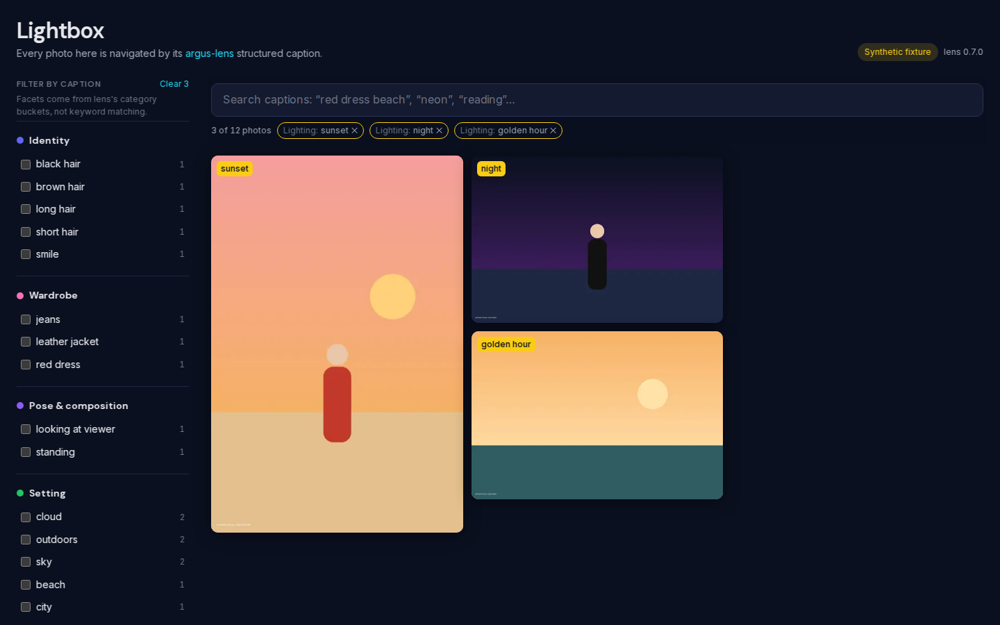
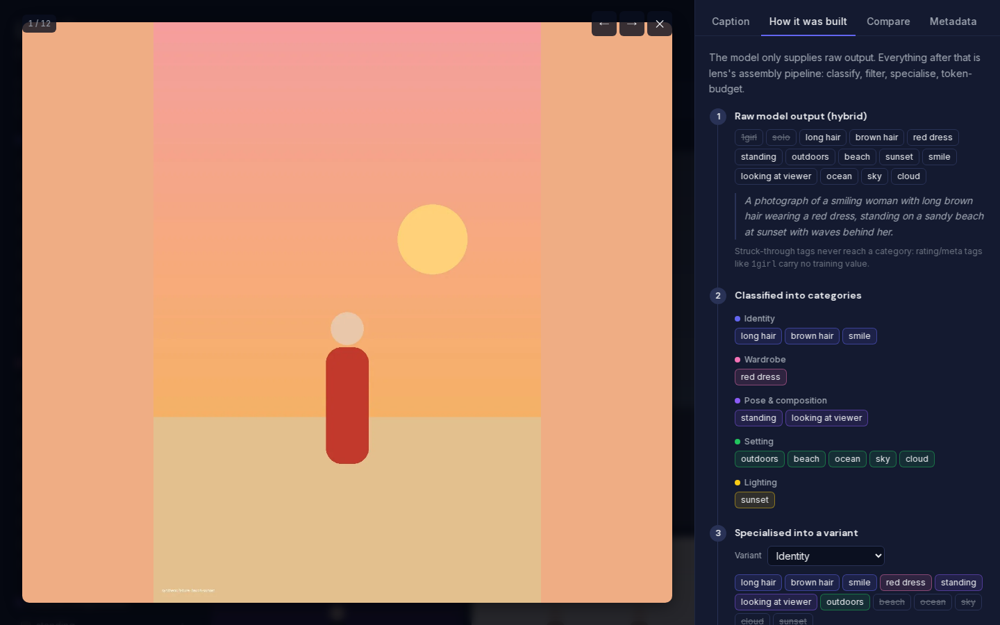
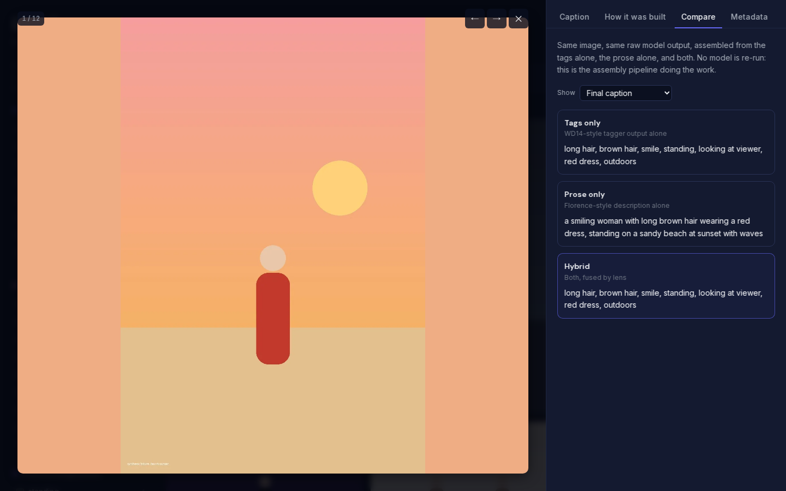

# Argus Lightbox

<!-- Live demo: https://lightbox.dragonhound.dev -->

A photo gallery you navigate by **structured captions**. Every photo is captioned by [argus-lens](https://github.com/smk762/argus-lens). Instead of one flat string, lens produces category-bucketed captions (identity, wardrobe, pose, setting, lighting, action), and Lightbox turns those buckets into filters. You can pick "red dress" under *Wardrobe* and "sunset" under *Lighting*, open a photo, and see how lens assembled its caption from the raw model output.

It's the standalone demo for argus-lens. The full pipeline UI is [Argus Studio](https://github.com/smk762/argus-studio).



| How a caption was built | Same raw output, assembled three ways |
|---|---|
|  |  |

## What it shows

- **Faceted filtering from lens's category buckets.** The filters aren't keyword matches. They're the tag fragments lens classified into each category. Terms within a category widen the results (OR), and categories narrow them (AND). A photo card shows which of its terms matched. There's also a headcount facet (lens's subject estimate) and a camera facet from EXIF.
- **Free-text search** across the final caption, every variant, and the raw model output.
- **The caption and its variants:** one per category, plus the `training` (identity-suppressed) and `zeroshot` variants, with copy buttons and the active filters highlighted.
- **How it was built.** Raw tags and prose, which tags were dropped as meta noise (`1girl`, `solo`), how fragments were classified, and which ones each variant kept or trimmed, plus lens's own compaction notes and headcount evidence.
- **Compare.** The same raw output assembled tags-only, prose-only and hybrid. No model is re-run, which shows that the value is in the assembly, not the model.
- **Metadata and sidecars.** EXIF (camera, lens, exposure; **never GPS**), provenance and licence, and the two sidecars lens writes: the `.txt` caption trainers read, and an XMP file (keywords + description) for Lightroom, digiKam and Immich.

Face grouping and content rating are left out. They are the curator demo, [argus-cull](https://github.com/smk762/argus-cull). This gallery only links there.

## How it works

```
cortex lineage store ──▶ bake/ (Python) ──▶ web/public/data/ ──▶ web/ (Next.js static export)
  recorded captions        re-run lens assembly    index.json            no server, no API
  + image blobs            on the raw output (CPU) images/ thumbs/ xmp/
```

The site is **fully static**. A bake step does all the work ahead of time:

1. It reads the **recorded pipeline run** (the "tape" that [argus-halo](https://github.com/smk762/argus-halo) seeds the public demo with): the latest caption per asset from the cortex lineage store, and image bytes from the cortex blob store.
2. It re-runs lens's `compose_caption_result()` on each caption's stored raw tags and prose. This needs no model or GPU, and it recovers the intermediate assembly state the tape doesn't store: the per-category buckets, compaction notes, headcount, and the tags/prose/hybrid comparison. The **recorded** caption stays what's displayed. If the pinned lens release would now assemble it differently, the photo is flagged (`explain.drift`).
3. It writes web renditions (WebP display image + thumbnail, re-encoded so no source metadata survives), display-ready EXIF with GPS dropped, the XMP sidecar lens would write, and `index.json`.

The web app loads `index.json` and does everything else client-side. All gallery state (search, filters, the open photo) lives in the URL, so any view can be shared.

### The fixture

`web/public/data/` holds a committed **synthetic fixture**: 12 drawn placeholder scenes with hand-written WD14/Florence-style raw output, captioned by lens's real pipeline. It lets the app run and be tested without the tape, and it's labelled "Synthetic fixture" in the UI. The real data comes from `make tape`.

## Quick start

Needs [uv](https://docs.astral.sh/uv/). Node 22 is optional: the Makefile runs npm in the `node:22` Docker image when `npm` isn't on your PATH.

```bash
make install     # bake venv + web dependencies
make dev         # http://localhost:3000, serving the committed fixture
```

Bake the real run from a cortex store, for example the local stores you recorded the tape from:

```bash
export CORTEX_PG_URL=postgresql://…                       # lineage store
export CORTEX_S3_ENDPOINT=… CORTEX_S3_BUCKET=argus-tape   # blob store (plus credentials)
make tape                                                 # → web/public/data-tape/ (committed: the hosted demo)
NEXT_PUBLIC_DATA_URL=/data-tape make dev
```

`lightbox-bake tape --dataset <name>` restricts the bake to one curated dataset, and `--limit N` caps it.

### A folder of your own photos

Docker Compose runs the gallery and a lens server. Nothing else has to be installed on the host. With no path set, it captions the Pictures folder in your home directory (`~/Pictures` on Linux and macOS, `%USERPROFILE%\Pictures` on Windows). `PHOTOS_DIR` points somewhere else: another local directory, a NAS share already mounted on this machine, or a USB drive.

```bash
docker compose up --build
# PHOTOS_DIR=/mnt/nas/library docker compose up --build
# PHOTOS_DIR=/run/media/$USER/USB/DCIM docker compose up --build
```

The site comes up at http://localhost:3000 as soon as the folder is counted. Photos already captioned are on the page; a “Click here to show new images” button loads the ones that have finished since, and the rest are counted as captions in queue. The grid shows thumbnails, 48 per page. The folder is mounted read-only, and no caption sidecars are written next to the originals. The first start downloads the models into a Docker volume. Later starts only send photos that are not already captioned. `RECAPTION=1` ignores that cache. `PHOTOS_LIMIT=20` captions the first 20 images in sorted path order and the gallery then lists only those, until a run without the limit. `make up` is the same command. `make purge` deletes the gallery and the caption cache, then starts the current folder again. It does not touch the photo folder or the downloaded lens models.

Changing the folder means setting `PHOTOS_DIR` and running `docker compose up -d` again. Compose only applies a new mount when it recreates the container. The gallery is then rebuilt from that folder. A photo whose bytes were captioned before is not sent to lens again. When the new bake finishes, renditions and cached captions for files that are not in this folder are removed. A limited run does not drop captions for files it never opened.

The caption is hybrid. RAM++ tags the photo in the lens container, and Florence writes the sentence. An Ollama or ComfyUI vision model, named in `.env`, replaces Florence and leaves the tags in place. The first start downloads both models into a Docker volume. RAM++ uses a GPU when `compose.gpu.yaml` passes one through, and the CPU otherwise. The WD14 tagger is not loaded. For an NVIDIA GPU, add the override:

```bash
docker compose -f compose.yaml -f compose.gpu.yaml up --build
```

Facet lists (which ordinary tags become filters, and which are left out) are `bake/src/lightbox_bake/facet_lists.example.json`. Set `FACET_LISTS_JSON` to a copy to replace them. A missing file keeps the example.

The Compose file pins [argus-lens 0.10.0](https://pypi.org/project/argus-lens/0.10.0/). `LENS_TAG` overrides that pin. A vocabulary pack can be added with `RAM_VOCAB_PACKS`. `ARGUS_BACKEND=florence2` or `openai-compat` drops the tags, and the Compare tab then has nothing to show. WD14 stays available for a booru or anime checkpoint: `ARGUS_BACKEND=hybrid`, or `ARGUS_BACKEND=hybrid:wd14+openai-compat` to keep those tags and still send the sentence to Ollama.

For a stronger description, copy `.env.example` to `.env` in this directory and fill in the hosts (Compose reads `.env`; it is not committed). Lens asks that server to describe the photo. A URL with no `/v1` gets one added. `COMFYUI_MODEL` has to be set as well, or the Ollama vision model keeps the caption.

```bash
OLLAMA_URL=http://host.docker.internal:11434 OLLAMA_MODEL=qwen3-vl:8b-instruct docker compose up --build
COMFYUI_URL=http://host.docker.internal:8188 COMFYUI_MODEL=joycaption docker compose up --build
```

ComfyUI's own workflow port does not caption anything until a vision model is served there in that OpenAI shape. When both URLs are set, ComfyUI writes the prose and Ollama is left for the optional rewrite below.

With `OLLAMA_URL` set, lens 0.10 rewrites every finished caption with `qwen3:8b` on that server. A rewrite is kept only when lens's own checks accept it. `OLLAMA_REFINE_MODEL` names a different rewriter and does not replace Florence. `ARGUS_REFINE=off` leaves the assembled caption. With no Ollama URL, refinement stays off. Captions cached before this rewrite are kept until the cache key changes or `RECAPTION=1` is set. `ARGUS_BACKEND=openai` and `OPENAI_API_KEY` still select the cloud backend instead.

The container has to be able to read the mount. On a NAS export that squashes root, the files need to be world-readable.

## Deploying

`make build` writes a static site to `web/out/`. Serve it from anything.

The hosted demo at https://lightbox.dragonhound.dev is `make pages`: the same export, reading the committed tape bake in `web/public/data-tape/` (29 public-domain/CC0 Commons photos from the halo tape), with the demo banner and absolute OG URLs. `.github/workflows/pages.yml` runs it on every push to `main` and uploads `web/out/` with `wrangler pages deploy`. After a change to the bake or a lens bump, re-run `make tape` against the tape's stores and commit `web/public/data-tape/`.

| Variable | Default | Purpose |
|---|---|---|
| `NEXT_PUBLIC_DATA_URL` | `<basePath>/data` | Where `index.json` and the renditions live. Point it at an R2/CDN URL to host the data separately from the app; that origin must send CORS headers for `index.json`. |
| `NEXT_PUBLIC_BASE_PATH` | (none) | Serve the app under a sub-path. |
| `NEXT_PUBLIC_SUITE_URL` | argus-studio repo | The "see the whole pipeline" link. |
| `NEXT_PUBLIC_CURATOR_URL` | argus-cull repo | The faces / content-rating cross-link. |
| `NEXT_PUBLIC_DEMO_BANNER` | (none) | Any value shows the "demo on recorded data" strip at the top. |
| `NEXT_PUBLIC_SITE_URL` | (none) | Absolute origin for `og:image` and the canonical link. |

These are build-time variables (inlined by Next.js), so rebuild after changing them.

`npm run build` also gives every page a strict, hash-based Content-Security-Policy (`web/scripts/csp.mjs`). It adds a `<meta>` that lists the sha256 of each inline script Next emitted and allows `NEXT_PUBLIC_DATA_URL`'s origin for fetches and images. It also writes `out/_headers` (Cloudflare Pages / Netlify format) for what a `<meta>` can't set: `frame-ancestors 'none'`, `X-Frame-Options`, `nosniff`, `Referrer-Policy` and `Permissions-Policy`. On another host, send those headers yourself.

## Develop

```bash
make test        # bake pytest + web vitest (runs against the committed fixture)
make lint        # ruff + eslint + tsc
make check       # lint + test + build: what CI runs
make fixture     # re-bake the fixture after changing bake/ or bumping lens
```

## Roadmap

- Move the tape bake to R2 if it outgrows the repo (`NEXT_PUBLIC_DATA_URL` already supports it).

## License

MIT
